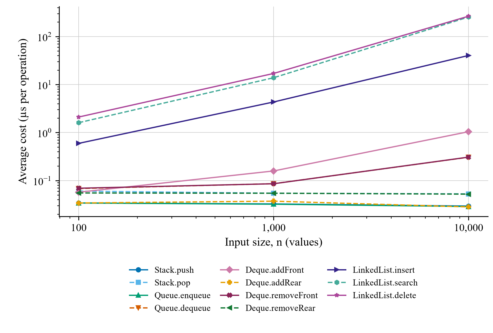

# LinearDS-Suite: Design, Implementation, and Performance Analysis of Linear Data Structures

Author: Shreyashkumar Patel
Institution: CSU Global
Course: CSC506 Design and Analysis of Algorithms
Instructor: ____________________
Date: October 11, 2026

<!-- TITLE PAGE END -->

## Abstract

LinearDS-Suite implements and evaluates four linear data structures in Python: Stack, Queue, Deque, and LinkedList. The project combines object-oriented classes, practical algorithms, automated tests, an interactive Streamlit interface, and repeatable performance measurements. Python lists provide storage for Stack, Queue, and Deque, while LinkedList uses individual Node objects. This report explains the public operations, ordering rules, error handling, algorithm behavior, and implementation-specific complexity of each structure. Eleven operation workloads were measured at input sizes of 100, 1,000, and 10,000 using independent timeit trials. The results show approximately constant average costs for list-end operations and increasing costs for front operations and linked traversal. Final validation in a clean environment produced 193 passing automated cases and successful browser rendering of all eight application pages. The findings demonstrate that selecting an appropriate structure requires considering both the required access policy and the actual representation used to implement it.

<!-- MAIN TEXT -->

Linear data structures organize values in a sequence but provide different rules for accessing and removing them. This project examines how those rules interact with implementation choices. Its objectives were to implement the assignment-required APIs, demonstrate appropriate problem-solving examples, validate behavior, compare theoretical and measured efficiency, and make the structures observable through an interactive interface. The submission snapshot is identified by the Git tag `v1.0-submission` (Patel, 2026). The following analysis distinguishes conclusions derived from the project source code from measurements recorded in its benchmark dataset.

## Project Architecture and Object-Oriented Design

The implementation separates reusable classes in `datastructure_src`, algorithm modules, automated tests, performance artifacts, documentation, and the Streamlit application. The UI calls the same classes and algorithms used by the tests. It therefore demonstrates the submitted implementations directly, rather than maintaining a second implementation of their behavior. Databases, authentication, APIs, and cloud deployment were outside the project scope.

Each class initializes its own storage, preventing different instances from accidentally sharing values. Stack, Queue, and Deque manage an internal `_items` list; LinkedList manages an internal `_head` reference. Public methods provide abstraction, while underscore-prefixed attributes communicate encapsulation by convention rather than enforcing access restrictions. LinkedList demonstrates composition because it manages Node objects whose `data` and `next` attributes form a chain. These design choices apply Python's model of classes, instance state, and methods (Python Software Foundation [PSF], n.d.-a). Assignment-specific names such as `isEmpty()` and `addFront()` remain unchanged.

## Data Structure Implementations

### Stack

Stack follows last-in, first-out (LIFO) ordering. `push(item)` appends a value and returns `None`; `pop()` removes and returns the newest value; `peek()` returns that value without removal; and `isEmpty()` returns a boolean. Empty `pop()` and `peek()` calls raise `IndexError`. For example, pushing 10 and then 20 produces a pop order of 20 followed by 10. Using the list's final position avoids shifting remaining references. Python's documented list-as-stack pattern uses the same append and end-pop operations (PSF, n.d.-c).

### Queue

Queue follows first-in, first-out (FIFO) ordering. `enqueue(item)` appends at the rear and returns `None`; `dequeue()` removes and returns index zero; `front()` reads that position without removal; and `isEmpty()` checks the state. Empty removal and front inspection raise `IndexError`. Tasks A, B, and C therefore leave in their arrival order. The ordering is appropriate for service lines, but this implementation's `pop(0)` shifts later references. Queue semantics alone do not guarantee constant-time removal.

### Deque

Deque provides access at both ends. `addFront(item)` inserts at index zero, while `addRear(item)` appends. Both return `None`. `removeFront()` and `removeRear()` remove and return the corresponding endpoint; both raise `IndexError` when empty. `isEmpty()` returns a boolean. The front is consistently index zero, making mixed operations predictable. However, front insertion and removal shift references, while rear operations avoid that shifting. This project's list-backed Deque consequently has asymmetric operation costs despite its symmetric interface.

### Node and LinkedList

Each Node stores a value in `data` and initially sets `next` to `None`. LinkedList is singly linked and preserves insertion order. `insert(data)` appends a new node and returns `None`; it traverses the chain because no tail reference is maintained. `delete(data)` removes the first equal value and returns whether removal succeeded. A missing value returns `False` without changing the list. `search(data)` returns a boolean, and `display()` returns text such as `10 -> 20 -> 30 -> None`; an empty list displays `None`. Head, middle, and final-node deletion preserve the remaining links and later duplicates.

## Theoretical Complexity

Table 1 summarizes the costs derived from the actual method bodies. Here, n denotes the number of stored values, and value equality is assumed to take constant time. Amortized costs describe a sequence of operations, not a guarantee about every individual call. For example, an occasional resize can make a list-end operation linear even though its amortized cost is constant. Every structure also provides `to_list()`, an O(n) shallow snapshot that supports visualization without exposing the storage container itself.

**Table 1**
*Implementation-Specific Operation Complexity*

| Structure | Operation | Time | Implementation detail |
|---|---|---|---|
| Stack | push | O(1) amortized | A resize can cost O(n). |
| Stack | pop | O(1) amortized | A list shrink can cost O(n). |
| Stack | peek / isEmpty | O(1) | Read the last item or list length. |
| Queue | enqueue | O(1) amortized | Append at the rear; resize can cost O(n). |
| Queue | dequeue | O(n) worst case | pop(0) shifts the remaining references. |
| Queue | front / isEmpty | O(1) | Read index zero or list length. |
| Deque | addFront / removeFront | O(n) worst case | Front insertion/removal shifts references. |
| Deque | addRear / removeRear | O(1) amortized | End operations; resizing can cost O(n). |
| Deque | isEmpty | O(1) | Check list length. |
| LinkedList | insert | O(n) worst case | Walk to the end; empty-list insertion is O(1). No tail reference. |
| LinkedList | search / delete | O(n) worst case | Locate the first match; a head match is O(1). |
| LinkedList | display | O(n + L) | Visit n nodes and format L output characters (assuming simple values). |
| All four | to_list | O(n) | Copy or traverse n references into a shallow snapshot. |

*Note.* L is the number of formatted output characters. Display costs assume ordinary values whose formatting cost is proportional to output length. All four structures require O(n) storage, excluding the sizes of the stored payloads. A snapshot adds O(n) references but does not deep-copy mutable payloads. A LinkedList head match is O(1); searching for a final or missing value is O(n). Costs are derived from the submission source (Patel, 2026).

Repeated operations change the total workload cost. Building n values through list-end addition is O(n) amortized, while building through Deque front addition or LinkedList append is O(n²). Draining Queue or the front of Deque is also O(n²). LinkedList deletion changes only a link after locating a match, but its value-based API must perform that search first. General deletion therefore remains O(n), even though the final reference update is constant-time.

## Problem-Solving Algorithms

### Balanced Parentheses With Stack

`is_balanced_parentheses(expression)` stores opening brackets and matches each closing bracket against the most recent opener. It supports parentheses, square brackets, and braces. `{[()]}` returns `True`, while `([)]` returns `False`. Non-bracket characters are ignored, and empty input is balanced. The function checks bracket structure rather than parsing quoted strings or comments. Each character is examined once, yielding O(m) time and O(m) worst-case auxiliary storage for m input characters.

### FIFO Task Processing With Queue

`process_tasks(tasks)` accepts an iterable, enqueues its values, and returns them in processing order. It simulates service order without executing task payloads or modifying the input collection. Empty input returns an empty list. Tasks A, B, and C produce the same ordered result. Building the queue is O(t) amortized, but draining its list front makes the complete simulation O(t²) for t tasks. The example demonstrates correct FIFO behavior while revealing the representation's scaling cost.

### Palindrome Checking With Deque

`is_palindrome(text)` adds characters at the rear and compares characters removed from opposite ends. It returns a boolean and compares exact characters, including case, spaces, punctuation, and Unicode code points. Thus, `racecar` is accepted and `Racecar` is rejected; empty text and single characters are accepted. A matching input can require O(m²) time because repeated front removal shifts references. Auxiliary storage is O(m). The function does not normalize case, discard punctuation, or implement linguistic grapheme analysis.

### Dynamic Task Management With LinkedList

`manage_tasks(tasks, task_to_remove, task_to_find)` builds an ordered chain, records its initial display, removes the first matching task, searches the updated list, and returns the initial sequence, removal status, search status, and updated sequence. Removing Task B from A, B, C leaves A, C. Search occurs after removal, so a remaining duplicate can still be found. Empty inputs and missing values are handled without exceptions. Building t values is O(t²) here, followed by linear deletion, search, and display under ordinary formatting assumptions.

## Interactive Interface and State Management

The application provides Home, Stack, Queue, Deque, Linked List, Algorithms, Performance, and Comparison pages. Structure pages expose every required operation, a current-state visualization, a clear control, and a related example. Stack is shown from top to bottom; Queue and Deque show front-to-rear order; LinkedList displays its node chain. UI values are entered as text, while the underlying classes accept general Python values. Blank UI entries are rejected, and invalid empty-state operations display clear errors.

Actual structure objects are stored in `st.session_state`, which retains values across reruns and page switches within a user session (Snowflake, n.d.-b). Separate sessions own separate objects. Browser refresh or a new session creates fresh state, and algorithm forms use separate objects so examples do not alter the interactive collections. Final validation found and corrected a first-visit routing issue: opening a child page directly now initializes the shared application before rendering that destination. The Performance page reads saved JSON and does not execute benchmarks; Comparison presents selection guidance and the written analysis. Local startup does not require an email address.

## Testing and Final Validation

Validation covered ordering, return values, empty operations, duplicate values, object identity, instance independence, linked deletion positions, and algorithm edge cases. UI tests use Streamlit's AppTest to interact with actual widgets, inspect output, and verify state transitions; the framework supports testing rendered elements and session values without depending exclusively on manual browser actions (Snowflake, n.d.-a). Table 2 lists the collected automated cases. The total is a count of cases, including parameterized inputs, rather than a claim of 100% code coverage.

**Table 2**
*Automated Test Cases by Module*

| Test module | Cases | Main verification |
|---|---:|---|
| test_stack.py | 33 | LIFO, inspection, errors, and bracket matching |
| test_queue.py | 18 | FIFO, front inspection, errors, and service order |
| test_deque.py | 41 | Both endpoints, ordering, errors, and palindromes |
| test_linked_list.py | 35 | Nodes, search, deletion positions, and tasks |
| test_snapshots.py | 4 | Snapshot order and storage-container isolation |
| test_performance.py | 9 | Fresh trials, parameter checks, JSON, and CLI |
| test_streamlit_app.py | 53 | Widgets, navigation, state, algorithms, and errors |
| Total | 193 | All cases passed in final validation |

*Note.* Counts were collected from the completed submission. The final clean-environment run passed all 193 cases. Seven of the UI cases specifically cover first visits directly to child pages.

A separate checkout and newly created virtual environment installed dependencies successfully and passed `pip check`. Validation used Windows, CPython 3.14.4, Streamlit 1.65.0, and pytest 9.1.1. The complete benchmark ran, and Chrome rendered all eight pages, including the performance chart and the corrected startup path. Documentation links and four README examples were also checked. The repository retained meaningful commits, contained no tracked caches or temporary files, and was marked with `v1.0-submission`. Runtime dependencies are limited to pytest and Streamlit; the classes and benchmark use the standard library.

## Performance Measurement Method

Eleven workloads were measured at n = 100, 1,000, and 10,000, producing 33 operation-size combinations. Each used one untallied warm-up and five independent trials. A `timeit.Timer` setup callback constructed fresh input before each trial; `number=1` prevented destructive workloads from reusing already-drained state. Preparation and file output were excluded, while workload loops, method calls, insertion allocation, and reference handling remained timed. The recorded statistic is the minimum full-trial duration, consistent with timeit's guidance for reducing interference from other activity. Its default timer is `perf_counter`, and cyclic garbage collection is disabled during each trial (PSF, n.d.-d).

Insertion workloads build n values from empty. Removal workloads drain n preloaded values. LinkedList search performs 100 last-node probes at a constant size, while deletion removes one last node from a fresh chain. Average microseconds per operation equal the best trial's seconds multiplied by 1,000,000 and divided by its operation count. The dataset was recorded on October 10, 2026, using CPython 3.14.4 on Windows 11. Table 3 contains all measured averages; Figure 1 plots the same stored values. These are original project measurements, not externally published performance guarantees (Patel, 2026).

**Table 3**
*Measured Average Operation Cost at Three Input Sizes*

| Operation | Trial workload | n = 100 | n = 1,000 | n = 10,000 |
|---|---|---:|---:|---:|
| Stack.push | Build n values | 0.034000 | 0.032500 | 0.029350 |
| Stack.pop | Drain n values | 0.060000 | 0.054400 | 0.052620 |
| Queue.enqueue | Build n values | 0.034000 | 0.032100 | 0.028710 |
| Queue.dequeue | Drain n values | 0.068000 | 0.085800 | 0.305860 |
| Deque.addFront | Build n values | 0.057000 | 0.158100 | 1.039570 |
| Deque.addRear | Build n values | 0.034000 | 0.037100 | 0.028170 |
| Deque.removeFront | Drain n values | 0.069000 | 0.085600 | 0.307030 |
| Deque.removeRear | Drain n values | 0.055000 | 0.054300 | 0.051990 |
| LinkedList.insert | Build n values | 0.594000 | 4.326500 | 40.303710 |
| LinkedList.search | 100 last-node searches | 1.601000 | 13.844000 | 254.983000 |
| LinkedList.delete | One last-node deletion | 2.100016 | 17.000013 | 265.099981 |

*Note.* Values are microseconds per operation, computed from the minimum of five full trials. Build and drain rows average n operations over growing or shrinking collections. Search averages 100 full-length probes; deletion measures one final-node deletion. Decimal places reproduce the stored calculation and do not imply equivalent timer accuracy. Setup, UI rendering, and file output are excluded.

**Figure 1**
*Observed Growth of Average Operation Costs*



*Note.* Both axes are logarithmic so that small list-end costs and larger traversal costs remain visible. Points are the saved measurements from Table 3; connecting segments indicate observed changes rather than a fitted complexity model. Some list-end curves overlap.

## Results, Tradeoffs, and Limitations

At n = 10,000, building Stack took 0.2935 ms, compared with 403.0371 ms for LinkedList. The latter repeatedly traverses a growing chain. Draining Queue took 3.0586 ms, compared with 0.5262 ms for Stack pop. These operations impose different ordering policies, but their differing costs illustrate the impact of shifting references at the front. Last-node LinkedList search and deletion also increased with input size. The trends are consistent with the source-derived bounds, while small timing fluctuations reflect overhead and environmental variation.

Selection should begin with the access policy. Stack fits newest-first work such as undo or bracket matching. Queue fits arrival-order service. Deque is appropriate when both ends matter, while LinkedList expresses an ordered node chain with value-based updates. Equal Big-O bounds do not imply equal constants: shifting references within Python's list implementation can be faster than walking Python Node objects for these inputs. A linked representation also adds per-node allocation and reference overhead, although this project did not measure memory consumption.

The benchmark covers only three sizes in one environment. Its minimum statistic is not a confidence interval, and a single-deletion trial is sensitive to callable and scheduling overhead. Batch averages cannot be treated as fixed-size single-call measurements. No end-to-end latency, memory benchmark, randomized workload, or production-scale evaluation was conducted. Potential alternatives include maintaining a LinkedList tail reference or using the standard-library `collections.deque`, whose endpoint operations are designed to be efficient (PSF, n.d.-b). Those alternatives would change the implementation and were not included in the submitted project.

## Conclusion

LinearDS-Suite satisfies the supplied implementation, algorithm, testing, visualization, performance, and documentation requirements. Its main analytical finding is that correct ordering behavior and efficient scaling are distinct concerns. The shared object-oriented design keeps the UI, algorithms, and tests consistent, while the benchmark exposes costs introduced by list shifting and linked traversal. The 193-case validation supports behavioral reliability for the tested scenarios; the measured growth and source analysis support choosing structures according to workload and representation rather than their names alone.

## References

Patel, S. (2026). *LinearDS-Suite* (Version 1.0-submission) [Computer software]. GitHub. https://github.com/Shreyash2942/LinearDS-Suite/tree/v1.0-submission

Python Software Foundation. (n.d.-a). *Classes*. Python 3.14 documentation. Retrieved October 11, 2026, from https://docs.python.org/3.14/tutorial/classes.html

Python Software Foundation. (n.d.-b). *collections—Container datatypes*. Python 3.14 documentation. Retrieved October 11, 2026, from https://docs.python.org/3.14/library/collections.html

Python Software Foundation. (n.d.-c). *Data structures*. Python 3.14 documentation. Retrieved October 11, 2026, from https://docs.python.org/3.14/tutorial/datastructures.html

Python Software Foundation. (n.d.-d). *timeit—Measure execution time of small code snippets*. Python 3.14 documentation. Retrieved October 11, 2026, from https://docs.python.org/3.14/library/timeit.html

Snowflake. (n.d.-a). *Get started with app testing*. Streamlit documentation. Retrieved October 11, 2026, from https://docs.streamlit.io/develop/concepts/app-testing/get-started

Snowflake. (n.d.-b). *Session state*. Streamlit documentation. Retrieved October 11, 2026, from https://docs.streamlit.io/develop/api-reference/caching-and-state/st.session_state

## Appendix A

### Reproducibility and Submission Artifacts

The project root contains README setup instructions, requirements, and Git ignore rules. `datastructure_src` contains the four class packages and algorithms; `tests` contains the seven test modules; `performance` contains the benchmark, comparison metadata, and saved results; `streamlit_app` contains the entrypoint, shared helpers, and seven child pages; and `docs` contains analysis, performance comparison, and the submission checklist. The original planning documents remain in `project doc`. The six-day sequence completed Stack, Queue/Deque, LinkedList, the UI, analysis/benchmarking, and final validation in that order.

From the project root, the following PowerShell commands recreate the documented environment and validate the project. The separate local output preserves the archived measurements used in this report.

```powershell
python -m venv .venv
.\.venv\Scripts\python.exe -m pip install -r requirements.txt
.\.venv\Scripts\python.exe -m pip check
.\.venv\Scripts\python.exe -m pytest -q
.\.venv\Scripts\python.exe -m performance.benchmark `
    --output performance/local_results.json
.\.venv\Scripts\python.exe -m streamlit run streamlit_app/app.py
```

Open the printed local URL, navigate through the pages, and stop the server with `Ctrl+C`. The final implementation commit is `806b63d`, identified by `v1.0-submission`. This report documents that source snapshot and its archived results; generating a new result file can change measured values without changing the algorithmic analysis.
